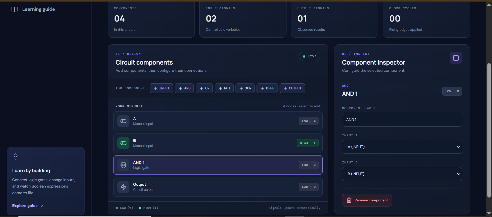
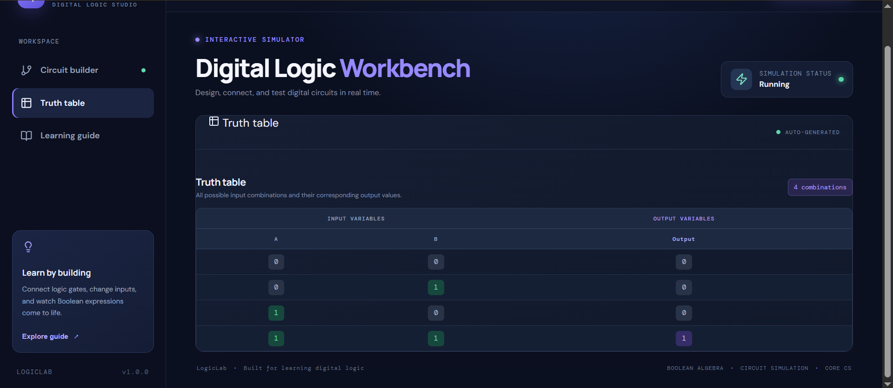
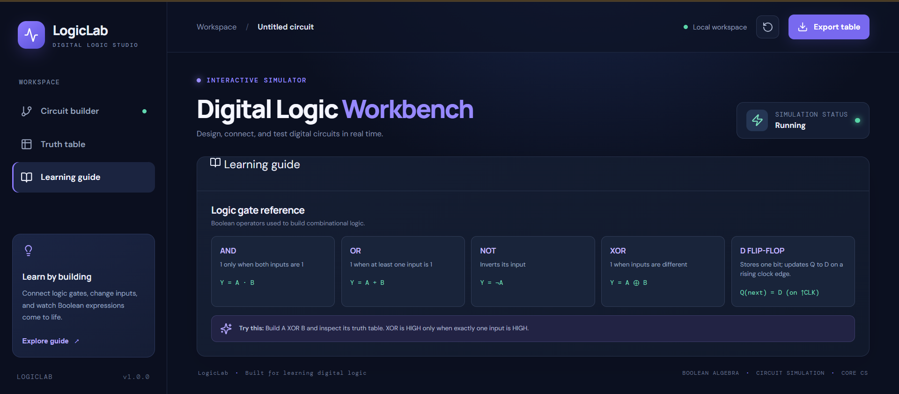
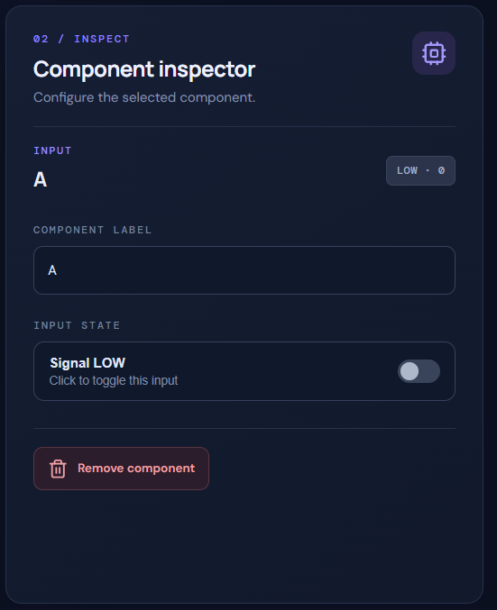

# ⚡ LogicLab — Interactive Digital Logic Studio

An **interactive digital logic simulator** built with React, JavaScript, and Vite. LogicLab allows students and beginners to explore digital logic by building circuits, connecting logic gates, changing input signals, and generating truth tables.

---

# 🖥️ Application Preview

<table>
  <tr>
    <td align="center">
      
      <br>
      <b>Circuit Builder</b>
    </td>
    <td align="center">
      
      <br>
      <b>Truth Table</b>
    </td>
  </tr>
  <tr>
    <td align="center">
      
      <br>
      <b>Learning Guide</b>
    </td>
    <td align="center">
      
      <br>
      <b>Component Inspector</b>
    </td>
  </tr>
</table>

---

# 📌 Overview

LogicLab is an educational digital logic simulator designed to make learning Boolean algebra and digital circuits more interactive and accessible.

The application provides a visual environment where users can create logic circuits, configure component connections, manipulate binary inputs, and observe the resulting outputs in real time.

LogicLab combines circuit simulation, automatic truth-table generation, and introductory learning materials in one application.

It is designed primarily for students, beginners, and individuals interested in understanding the fundamentals of digital logic and computer hardware.

---

# ✨ Features

- ⚡ **Interactive Circuit Builder** — Create and configure digital logic circuits.
- 🔌 **Multiple Logic Gates** — Supports AND, OR, NOT, and XOR gates.
- 🔢 **Binary Input Controls** — Toggle input signals between LOW (0) and HIGH (1).
- 📤 **Output Components** — Display the evaluated output of connected circuits.
- 🔍 **Component Inspector** — Edit component names and configure connections.
- 🔄 **Real-Time Circuit Evaluation** — Automatically update circuit results when inputs or connections change.
- 📊 **Automatic Truth Table Generation** — Generate possible input combinations and their corresponding outputs.
- 📥 **CSV Export** — Download generated truth tables in CSV format.
- ⏱️ **D Flip-Flop Simulation** — Simulate a positive-edge-triggered D flip-flop using a manual clock pulse.
- 📖 **Learning Guide** — Explore descriptions and Boolean expressions of supported logic components.
- 🧭 **Separate Navigation Pages** — Access Circuit Builder, Truth Table, and Learning Guide through the sidebar.
- 🌙 **Dark-Themed Interface** — Clean and modern interface designed for an interactive learning experience.
- 📱 **Responsive Layout** — Designed to accommodate different screen sizes.

---

# 🛠️ Technologies Used

## Programming Language
- JavaScript
- HTML5
- CSS3

## Front-End Framework
- React
- Vite

## Icons and Interface
- Lucide React

## Development Tools
- Visual Studio Code
- Node.js
- npm
- Git
- GitHub

---

# 🚀 Installation and Setup

Follow these instructions to install and run LogicLab on your local machine.

## 1. Clone the Repository

Replace `your-username` with your GitHub username.

```bash
git clone https://github.com/your-username/LogicLab.git
```

## 2. Navigate to the Project Folder

```bash
cd LogicLab
```

## 3. Install Dependencies

```bash
npm install
```

**Windows PowerShell users:** If you encounter an error stating that `npm.ps1` cannot be loaded because script execution is disabled, use:

```powershell
npm.cmd install
```

This allows you to install dependencies without changing your PowerShell execution policy.

## 4. Run the Development Server

```bash
npm run dev
```

For Windows PowerShell, if necessary:

```powershell
npm.cmd run dev
```

Vite will provide a local development URL, usually:

```text
http://localhost:5173/
```

Open the displayed URL in your browser to access LogicLab.

---

# 📖 How to Use LogicLab

## 1. Circuit Builder

The Circuit Builder allows users to create and configure digital logic circuits.

1. Open the Circuit Builder page from the sidebar.
2. Select a component from the component toolbar.
3. Add INPUT, AND, OR, NOT, XOR, D-FF, or OUTPUT components.
4. Select a component from the circuit list.
5. Use the Component Inspector to rename components and configure their connections.
6. Toggle input signals between LOW (0) and HIGH (1).
7. Observe how the circuit outputs change automatically.

A starter circuit is provided when the application opens, consisting of two inputs connected to an AND gate and an output component.

## 2. Truth Table

The Truth Table page displays all possible combinations of input signals and their corresponding output values.

1. Open the Truth Table page from the sidebar.
2. Review the input and output variables.
3. Examine the generated combinations.
4. Use the Export Table feature to download the results as a CSV file.

The current implementation supports up to 8 input variables, producing a maximum of 256 combinations.

## 3. Learning Guide

The Learning Guide provides introductory information about the supported digital logic components.

Users can review:
- AND Gate
- OR Gate
- NOT Gate
- XOR Gate
- D Flip-Flop

Each component includes a description of its logical behavior and corresponding Boolean expression where applicable.

## 4. D Flip-Flop Simulation

LogicLab includes a simplified D flip-flop simulation.

1. Add a D-FF component.
2. Select the component.
3. Connect a source to its D input.
4. Click the Pulse Clock button.
5. Observe the stored Q output.

The D flip-flop captures its D input on a rising clock edge and maintains its stored state between clock pulses.

---

# 🧠 Supported Logic Components

| Component | Description |
|---|---|
| INPUT | Provides a manually controlled binary signal. |
| AND | Produces HIGH when all inputs are HIGH. |
| OR | Produces HIGH when at least one input is HIGH. |
| NOT | Inverts the input signal. |
| XOR | Produces HIGH when its two inputs have different values. |
| D-FF | Stores one bit and captures its D input on a rising clock edge. |
| OUTPUT | Displays the signal received from a connected source. |

---

# ⚙️ Core Modules

- **Circuit Builder:** Provides the interface for adding, selecting, and configuring circuit components.
- **Logic Evaluator:** Evaluates Boolean operations and determines circuit outputs.
- **Truth Table Generator:** Produces possible input combinations and their corresponding outputs.
- **Component Inspector:** Allows users to configure component labels, inputs, and connections.
- **D Flip-Flop Controller:** Handles manual clock pulses and stored output states.
- **CSV Export:** Allows users to download generated truth-table data.
- **Learning Guide:** Provides explanations of supported digital logic components.

---

# 📂 Project Structure

```text
LogicLab/
│
├── index.html
├── package.json
├── vite.config.js
├── README.md
├── CONTRIBUTING.md
│
└── src/
    ├── main.jsx
    ├── App.jsx
    ├── logic.js
    └── styles.css
```

### File Descriptions

| File | Purpose |
|---|---|
| `index.html` | Main HTML entry point. |
| `package.json` | Contains project dependencies and development scripts. |
| `vite.config.js` | Configures the Vite development environment. |
| `src/main.jsx` | Initializes and renders the React application. |
| `src/App.jsx` | Contains the main interface, navigation, and application features. |
| `src/logic.js` | Handles Boolean gate evaluation, circuit evaluation, and truth-table generation. |
| `src/styles.css` | Contains the application's styling and responsive layout. |

---

# ⚠️ Limitations

Although LogicLab provides an interactive environment for exploring digital logic, some limitations apply:

- Truth-table generation is limited to 8 input variables.
- Truth tables are unavailable for circuits containing D flip-flops because sequential circuits depend on stored states and clock history.
- Unconnected gate inputs are treated as LOW (0).
- The D flip-flop uses a simplified positive-edge-triggered simulation.
- The simulator does not model physical electrical characteristics, propagation delays, setup time, or hold time.
- The application focuses on logical behavior rather than physical hardware implementation.

---

# 🔮 Future Improvements

Possible future enhancements include:

- Additional logic gates such as NAND, NOR, and XNOR.
- Drag-and-drop circuit construction.
- Visual connecting wires between components.
- Circuit saving and loading functionality.
- Additional sequential components, including JK and T flip-flops.
- Timing diagrams and clock waveform visualization.
- Multi-bit logic components.
- Interactive quizzes and learning activities.
- Expanded export options.
- Automated unit and integration testing.

These are proposed improvements and are not necessarily available in the current version.

---

# 👨‍💻 Developer

**Rheil Evans T. Lunio**

Computer Science Student

University of Science and Technology of Southern Philippines (USTP)

---

# 🤝 Contributing

Contributions, suggestions, bug reports, and feature improvements are welcome.

Please read [CONTRIBUTING.md](CONTRIBUTING.md) for guidelines on how to contribute to LogicLab.

---

# 📄 License

No license has been specified for this repository yet.

A suitable open-source license should be selected and included in a `LICENSE` file before the project is distributed under open-source licensing terms.

---

**LogicLab — Learn, Build, and Explore Digital Logic.**
